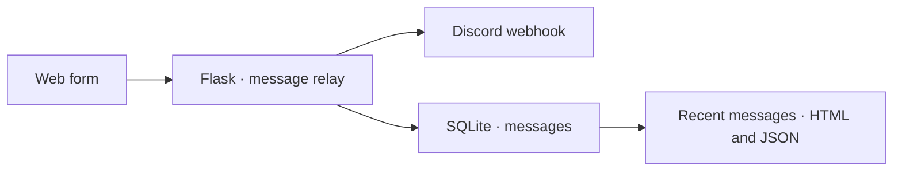

# 💬 Message Relay

A simple and stylish Flask web application that allows users to:

- ✍️ Submit a message through a form  
- 📤 Send the message to a Discord channel using a webhook  
- 🗃️ Store the message in a local SQLite3 database  
- 🔁 View all messages sent in the last 30 minutes  
- 🖥️ Use a modern, gamer-themed UI with JSON API access  

---

## At a glance




## 🚀 Features

- Flask backend with clean routing  
- SQLite3 for lightweight message storage  
- Discord Webhook integration for real-time message delivery  
- `.env` configuration for secure webhook storage  
- Gamer-style UI using Orbitron font + dark theme  
- `get_messages_json` endpoint for JSON-based retrieval  
- Messages shown in reverse chronological order  

---

## 📁 Project Structure

```
message-relay/
├── app.py                  
├── templates/
│   ├── index.html          
│   └── show_messages.html  
├── messages.db             
├── requirements.txt        
├── .env                     
├── .gitignore              
└── README.md              
```

---

## ⚙️ Getting Started

### 1. Clone the project

```bash
git clone https://github.com/Fadi7AY/flask-to-discord.git
cd flask-to-discord/message-relay
```

### 2. Create a virtual environment

```bash
python -m venv .venv
source .venv/bin/activate       # On Windows: .venv\Scripts\activate
```

### 3. Install dependencies

```bash
pip install -r requirements.txt
```

### 4. Create a `.env` file

```env
# .env
WEBHOOK_URL=https://discord.com/api/webhooks/your_webhook_url_here
```


### 5. Run the app

```bash
python app.py
```

Then open [http://127.0.0.1:5000](http://127.0.0.1:5000) in your browser.

---

## 📡 API Routes

| Method | Route                | Description                                  |
|--------|----------------------|----------------------------------------------|
| GET    | `/`                  | Redirect to `/get_messages`                  |
| GET    | `/get_messages`      | Render form + recent messages (HTML)         |
| POST   | `/input_text`        | Submit a new message                         |
| GET    | `/show_messages`     | Styled view of last 30 mins messages (HTML)  |
| GET    | `/get_messages_json` | JSON output of last 30 mins messages         |

---

## 🧠 Technologies Used

- Python 3  
- Flask  
- SQLite3  
- Discord Webhooks  
- HTML + CSS 

---
